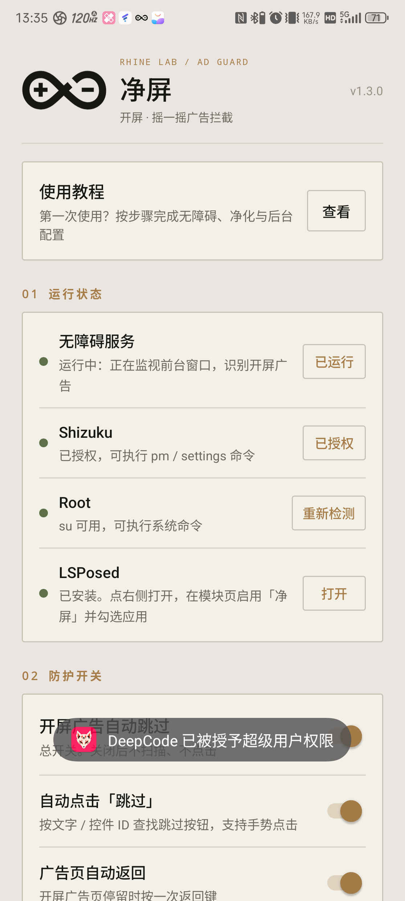
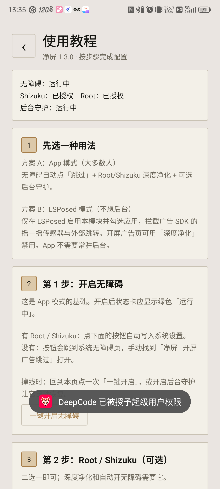
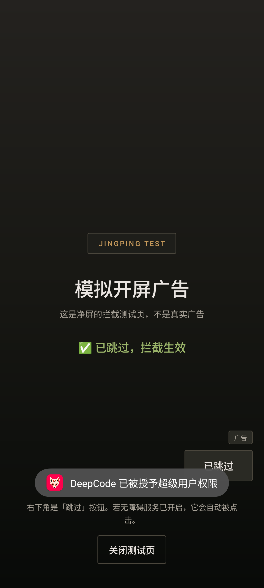

# 净屏（JingPing）1.3.0

一个本地运行的 Android 广告拦截工具，针对 **开屏广告** 与 **摇一摇广告**。
不需要修改任何应用的安装包；Root、Shizuku、LSPosed 都是可选的增强通道。

- 包名：`com.jingping.adshield`
- 版本：1.3.0（versionCode 4）
- 最低系统：Android 8.0（minSdk 26）
- 目标系统：Android 14（targetSdk 34），已在 Android 15 实机验证
- 测试机型：Nubia NX769J / Android 15
- 网络权限：**未申请**（应用不联网、不上传数据）

### 视觉语言

界面参考 [RhineLabUI](https://github.com/LBEILC/RhineLabUI)（MIT，LBEILC）：
暖灰纸面、墨黑字、琥珀金强调、细线档案卡片、编号式小标题、Rhine Lab 标志与淡网格底纹。
MiSans 未打包，使用系统 sans-serif / monospace，保持 APK 体积和字体许可干净。
Rhine Lab / 明日方舟相关权利归鹰角网络；本项目为非官方、非商业粉丝作品。

---

## 界面







---

## 下载

- [GitHub Releases · 最新 APK](https://github.com/NERRY3621/JingPing/releases/latest)
- 仓库源码：`https://github.com/NERRY3621/JingPing`

Release 中的 APK 使用本地测试签名；如需长期升级，请用自己的 keystore 重新构建。

---

## 1. 功能

### 内置图文教程（1.2.0 新增）
主界面顶部有「使用教程」入口，首次启动弹窗也可直接进入。教程按步骤覆盖：
App 模式 / LSPosed 模式怎么选、开启无障碍、Root/Shizuku 授权、选择应用、B 站深度净化、
后台守护、LSPosed 作用域、测试验证、恢复卸载和常见问题。

教程里的关键步骤都带按钮，可以一键开启无障碍、授权 Shizuku、管理应用、跳到深度净化、
开启后台守护、打开 LSPosed 和测试页，不用在设置里来回找。

### 开屏广告自动跳过（无需 Root）
通过无障碍服务监听前台窗口变化：

- 识别广告 Activity、`SplashShellActivity` 等开屏壳，普通应用启动后扫描 12 秒；
- 按文字「跳过 / 跳过广告 / skip」或控件 ID（`skip`、`ad_skip`、`close_ad` 等）查找按钮；
- **右下角的「跳过 3」也会点**，不再只认屏幕上半部分；
- 优先 `ACTION_CLICK`，不可点击时用无障碍手势点击兜底；
- 纯开屏广告页（如 `HotSplashActivity`）在找不到按钮时可按一次返回键；
- 支持 B 站、知乎、微博、小红书、抖音、快手、淘宝、京东、拼多多、美团、腾讯视频、爱奇艺、优酷、网易云音乐等常见应用；规则是通用的，其他应用也可直接生效。

### 后台守护（可选，需要时再开）
- 前台服务 + 常驻通知栏，避免进程被系统/厂商回收；
- 开机、应用更新后自动拉起；
- 无障碍掉线时，Root/Shizuku 可用则自动尝试恢复；
- 不开启时 App 不会常驻后台，仍然可以只使用 LSPosed 模块。

### 摇一摇跳转拦截（无需 Root，实验性）
广告页把用户“摇”到淘宝 / 京东 / 拼多多 / 浏览器时，立即按返回键退回原应用。
这是结果拦截，不能阻止 App 读取传感器。

### 深度净化（需要 Root 或 Shizuku）
枚举所选应用中的广告 SDK Activity，并通过系统 `pm disable` 禁用，例如：

- 穿山甲 / Pangle：`com.bytedance.sdk.openadsdk.*`
- 优量汇：`com.qq.e.*`
- 快手：`com.kwad.*`
- Mintegral：`com.mbridge.*`
- Unity / AppLovin / Vungle / ironSource / Chartboost / InMobi / Sigmob
- B 站自营开屏页：`tv.danmaku.bili.splash.ad.*`，重点是 `HotSplashActivity`
  （不会禁用启动壳 `SplashShellActivity`；禁用后 B 站冷启动直接进首页）

只处理 **Activity**，不碰 Service / Provider，降低启动崩溃风险。
修改的是系统组件状态，不改 APK；随时可在应用内点「恢复」还原为系统默认状态。
「恢复」会扫描所选应用里**所有已禁用的广告 Activity**（包括手动 `pm disable` 的），不只认 App 自己记录的清单。

### LSPosed 模块（可选，屏蔽摇一摇最彻底的方式）
APK 内置 LSPosed 模块，在目标应用进程内：

- 广告 SDK 注册加速度 / 线性加速度 / 重力传感器时直接返回失败，摇一摇拿不到数据；
- 广告 SDK 启动外部 Activity（购物 App / 浏览器 / deeplink）时直接拦截。

只有调用栈里出现广告 SDK 或广告代码（含 `com.bilibili.ad`、`tv.danmaku.bili.splash.ad`）时才动作，避免影响正常功能。
作用范围由 LSPosed 的模块作用域控制，建议只勾选需要防护的应用。

---

## 2. 安装

```bash
adb install -r JingPing-1.3.0.apk
```

或把 APK 传到手机后点击安装（需要允许“安装未知应用”）。

首次打开会显示欢迎页，可直接点「查看教程」。主界面从上到下是：

0. 使用教程入口
1. 运行状态（无障碍 / Shizuku / Root / LSPosed）
2. 防护开关
3. 生效范围
4. 深度净化
5. 自检（模拟开屏广告）
6. 运行日志

---

## 3. 首次配置

### 3.1 开启无障碍（必须）
- 有 Root 或已授权的 Shizuku：点「无障碍服务」右侧「开启」，应用会自动写入系统设置；
- 没有 Root / Shizuku：点「开启」会跳到系统无障碍页，手动找到「净屏 · 开屏广告跳过」并打开。

开启后状态应显示绿色「运行中」。
如果系统把服务杀掉，重新打开应用或重新勾选即可。

### 3.2 后台守护（可选）
如果希望 App 模式长期稳定，不想每次手动打开：

1. 打开「防护开关 → 后台守护」；
2. 允许通知权限；
3. 按弹窗把电池优化设为「不限制」，并在系统设置里允许自启动；
4. 通知栏出现「净屏后台守护中」即成功。

如果只想用 LSPosed 模块，保持「后台守护」关闭即可，App 不会常驻后台。

### 3.3 Root / Shizuku（二选一即可）
- **Root**：Magisk 等授予 `su` 权限后，状态显示「su 可用」；
- **Shizuku**：先安装并启动 Shizuku 服务，再回到净屏点「授权」，允许后状态显示「已授权」。

Root 优先；Root 不可用时自动回退到 Shizuku。
两者都没有时，自动跳过仍然可用，只是不能自动开无障碍、不能用深度净化。

### 3.4 LSPosed（可选）
1. 确认已安装 LSPosed（Zygisk 版）；
2. 在 LSPosed 管理器的「模块」页启用「净屏」；
3. 进入「作用域」，勾选要防护的应用（建议先勾 B 站、知乎、微博、小红书、抖音、快手、电商类）；
4. 强行停止并重新打开被勾选的应用，模块才会注入；
5. 需要更新模块后，同样要强行停止目标应用再打开。

> 说明：LSPosed 管理器可能寄生在 `com.android.shell` 中，普通包名查询查不到；
> 净屏会通过 Root/Shizuku 检查 `/data/adb/lspd` 判断是否安装。若「打开」按钮无法直接拉起管理器，
> 从通知栏点击 LSPosed 通知即可。

### 3.5 生效范围与深度净化
- 默认「全部应用」自动跳过；也可以关闭全局，在「管理」里只勾选需要的应用。
- 深度净化只处理「已勾选」的应用：
  1. 点「管理」勾选应用；
  2. 点「扫描组件」查看将要禁用的 Activity；
  3. 点「一键净化」执行；
  4. 需要还原时点「恢复」。

如果只想先解决 B 站开屏：勾选 B 站 → 扫描 → 一键净化。它会禁用
`tv.danmaku.bili/tv.danmaku.bili.splash.ad.page.HotSplashActivity`，之后冷启动直接进首页。

> 深度净化可能影响应用内的“看广告领奖励”等功能；不确定时先扫描、先小范围试用。
> 应用升级后组件可能恢复，重新扫描即可。

---

## 4. 自检

主界面点「开始测试」，会打开一个模拟开屏广告页：

- 右下角有「跳过 5」倒计时按钮；
- 无障碍服务正常时，约 1 秒内会自动点击，页面显示“✅ 已跳过，拦截生效”；
- 如果没有自动点击，检查无障碍服务是否绿色「运行中」。

---

## 5. 工作原理（简述）

```
前台窗口变化
   └─ 无障碍服务 SkipService
        ├─ 判断是否广告上下文（Activity 名 / 启动后 12 秒内）
        ├─ BFS 查找 跳过 文案 / skip 控件 ID
        ├─ 点击 / 手势点击 / 返回键
        └─ 监控外部 App 跳转 → 返回键拦截

深度净化
   └─ PackageManager 枚举 Activity
        └─ Root / Shizuku: pm disable --user 0 pkg/component

LSPosed
   └─ 目标应用进程内 hook
        ├─ SensorManager.registerListener（广告调用栈）
        └─ Instrumentation.execStartActivity / ContextImpl.startActivity
```

---

## 6. 从源码构建

不需要 Gradle。构建脚本使用 Android SDK 的 `aapt`、`d8`、`apksigner`、`zipalign` 和 JDK 17。

依赖：

- `android.jar`（API 34）
- `aapt`（build-tools，v1 即可）
- `d8.jar`、`apksigner.jar`（build-tools）
- `zipalign`
- OpenJDK 17
- 仓库内已带 Shizuku API 13.1.5 与 androidx annotation 的 jar

```bash
cd JingPing
bash build.sh
# 输出：dist/JingPing-1.3.0.apk
```

`build.sh` 顶部可通过环境变量覆盖工具路径：

```bash
SDK_JAR=/path/to/android.jar \
JAVA_HOME=/path/to/jdk17 \
D8_JAR=/path/to/d8.jar \
APKSIGNER_JAR=/path/to/apksigner.jar \
AAPT=/path/to/aapt \
ZIPALIGN=/path/to/zipalign \
bash build.sh
```

仓库**不包含签名私钥**（`release.jks` 已被 `.gitignore` 排除）。
`build.sh` 首次运行会在本地生成一个测试 keystore；正式升级或分发时请替换为自己的 keystore，并妥善保管，不要提交到仓库。

源码结构：

```
JingPing/
├── AndroidManifest.xml
├── build.sh
├── assets/xposed_init          # LSPosed 模块入口
├── libs/                       # Shizuku API / annotation
├── res/                        # 布局、颜色、无障碍配置
├── src/com/jingping/adshield/
│   ├── App.java
│   ├── MainActivity.java
│   ├── TestAdActivity.java
│   ├── core/                   # 配置、日志、Shell、规则、组件禁用
│   ├── service/SkipService.java# 无障碍跳过引擎
│   ├── ui/AppPicker.java
│   └── xposed/AdShieldHook.java# LSPosed 模块
└── stubs/                      # 仅编译期使用的 Xposed API 桩
```

---

## 7. 已知限制

- 没有 LSPosed 时，无法阻止 App 读取加速度传感器，「摇一摇」只能做事后跳转拦截；
- 部分应用把“跳过”绘制在 Canvas / SurfaceView 上，无障碍树没有节点，无法识别；
- 开屏广告如果 12 秒后才加载，可能错过扫描窗口；
- 深度净化只禁用 Activity，某些广告仍可能以 View / WebView 形式出现在信息流内；
- 不同厂商 ROM 的无障碍保活策略不同，必要时在电池优化里把净屏设为“不限制”；
- LSPosed 模块需要目标应用重新启动后生效。

---

## 8. 隐私与安全

- 不申请 `INTERNET` 权限，所有规则、日志、配置都在本机；
- 无障碍服务只读取窗口结构以查找“跳过”按钮，不读取账号、聊天内容，也不上传；
- 深度净化通过系统 `pm` 命令修改组件状态，可用「恢复」还原；
- 卸载净屏不会自动恢复已禁用的组件，卸载前请先在应用内点「恢复」。

---

## 9. 第三方组件

- Shizuku API 13.1.5（MIT，RikkaApps）—— 见 `THIRD_PARTY_NOTICES.md`
- AndroidX Annotation 1.3.0（Apache-2.0）
- RhineLabUI（MIT，LBEILC）—— 品牌标志路径与视觉语言，见 `THIRD_PARTY_NOTICES.md`
- Xposed API 仅使用编译期桩，不打包进 APK

---

## 10. 版本

- 1.3.0：融合 RhineLabUI 视觉语言（品牌标志、暖灰/墨黑/琥珀金、细线档案卡片、编号标题、网格底纹、全新启动图标），新增 APK 内 MIT 许可与署名。
- 1.2.0：内置图文教程与一键操作入口（首次启动可直达教程）；教程页实时显示无障碍/Root/Shizuku/守护状态，支持一键开启无障碍、授权 Shizuku、管理应用、跳到深度净化、开启后台守护、打开 LSPosed、打开测试页。
- 1.1.0：支持右下角「跳过」、普通应用扫描窗口延长到 12 秒；新增可选前台守护（开机自启 / 进程被杀后恢复 / 自动恢复无障碍）；深度净化改用 `pm disable`（修复 Android 15 上 `disable-user` 不生效）；恢复时扫描所有已禁用广告组件；B 站 `HotSplashActivity` 可直接禁用。
- 1.0.0：首个版本。开屏自动跳过、跳转拦截、Root/Shizuku 深度净化、LSPosed 传感器/跳转拦截模块。
